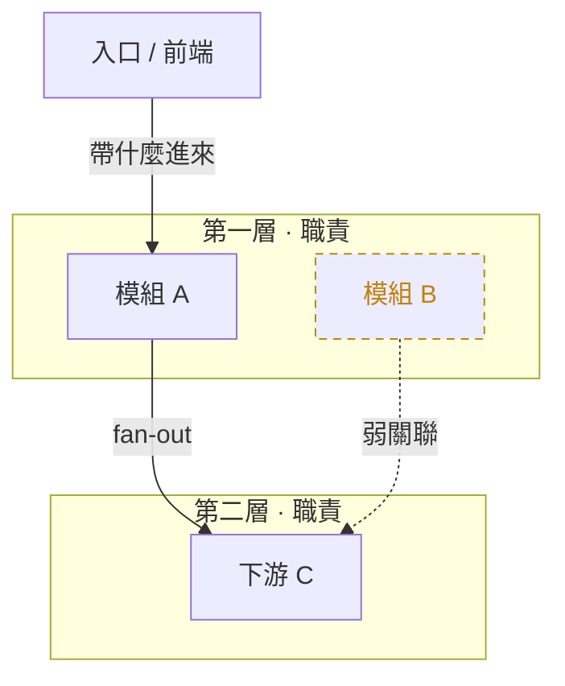
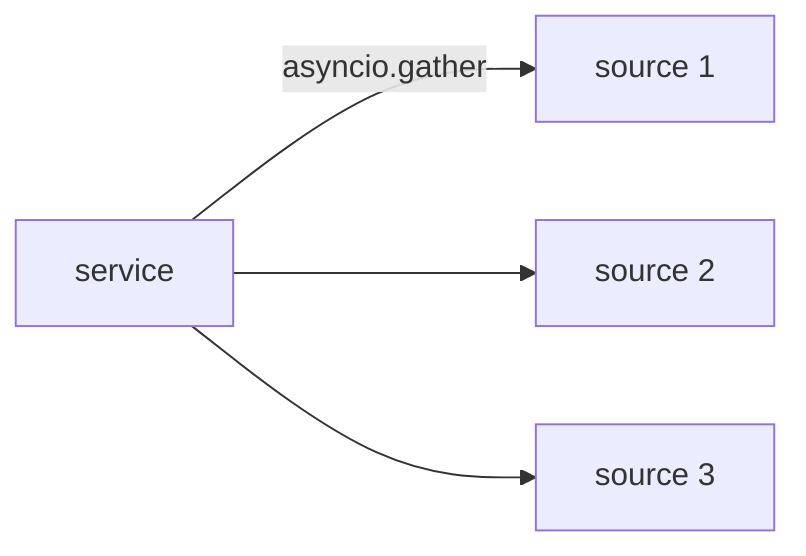
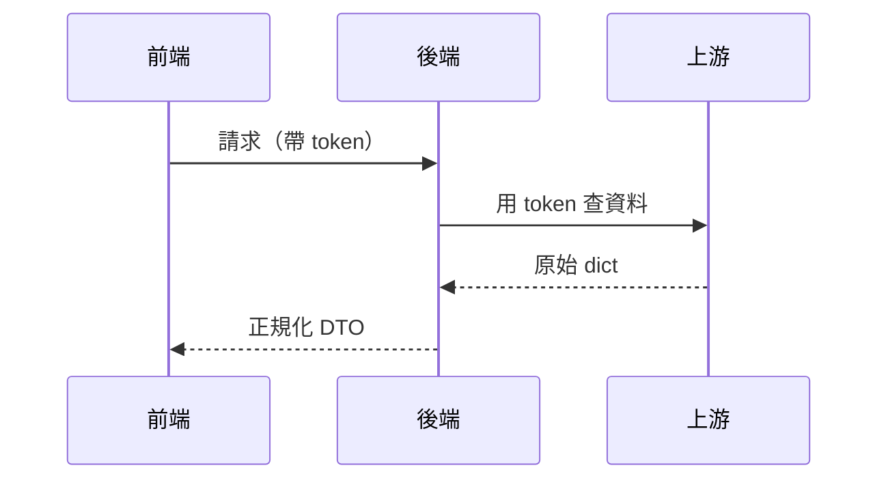
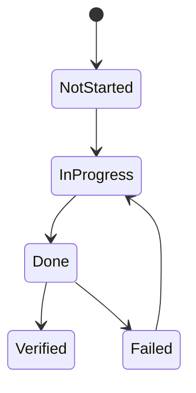
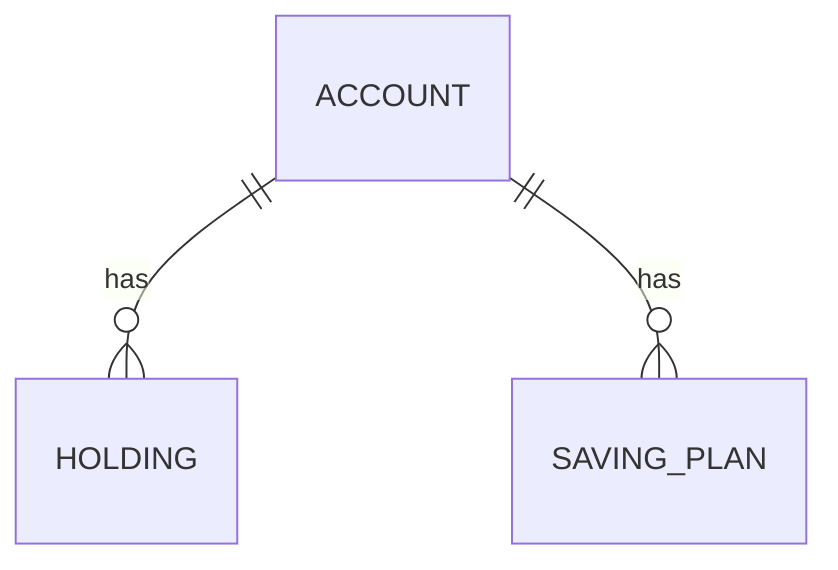

# Mermaid 圖型與版式速查

依內容挑圖型;分層架構是最常見的用途,放最前。

---

## 分層架構（flowchart + subgraph）— 預設

由上到下的分層,每層一個 `subgraph`,層內 `direction LR`。適合:api → 業務 → adapter → 上游這種分層系統。

要點:
- `flowchart TD` 主方向由上到下;`direction LR` 只在 subgraph 內排。
- fan-out:一個節點多條 `-->` 到多個下游(可寫 `A --> C & D`)。
- 旁支(dev-only)獨立成一條虛線鏈,視覺上與主流程分離。

## 資料流 / fan-out（強調一對多）

## 時序 / 互動順序（sequenceDiagram）
誰先呼叫誰、往返順序。適合:登入握手、下單到回報。

## 狀態機（stateDiagram-v2）
一個實體的狀態轉換。適合:task 生命週期、訂單狀態。

## 實體關係（erDiagram）
資料表 / 模型關聯。

---

## 常見語法陷阱
- 每個 `subgraph` 必須有對應 `end`。
- 節點文字含中文、括號、斜線、`.` 一律 `["..."]` 包住;換行 ` `。
- `classDef` 名稱要與 `:::name` 完全一致。
- 邊兩端的節點 id 必須已定義(或在該行首次定義)。
- `%%{...}%%` 舊式指令可不用;優先用開頭的 `--- config: ---` frontmatter。
